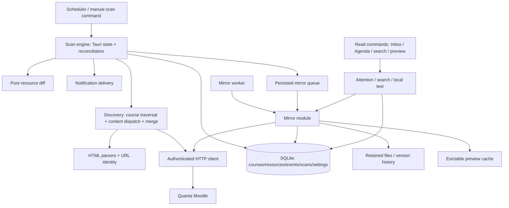
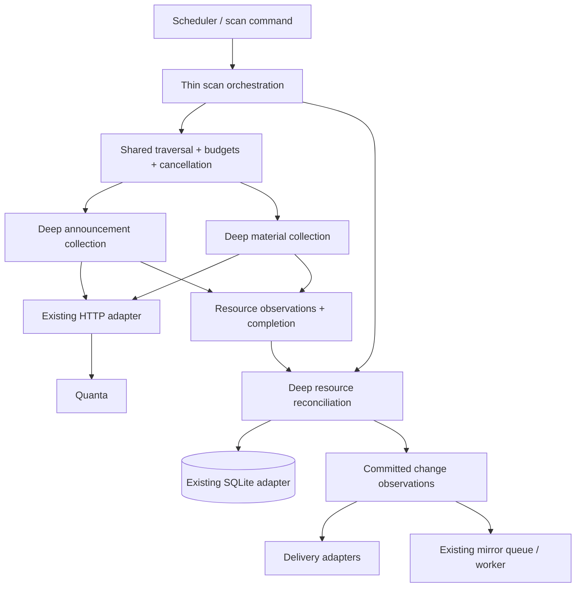
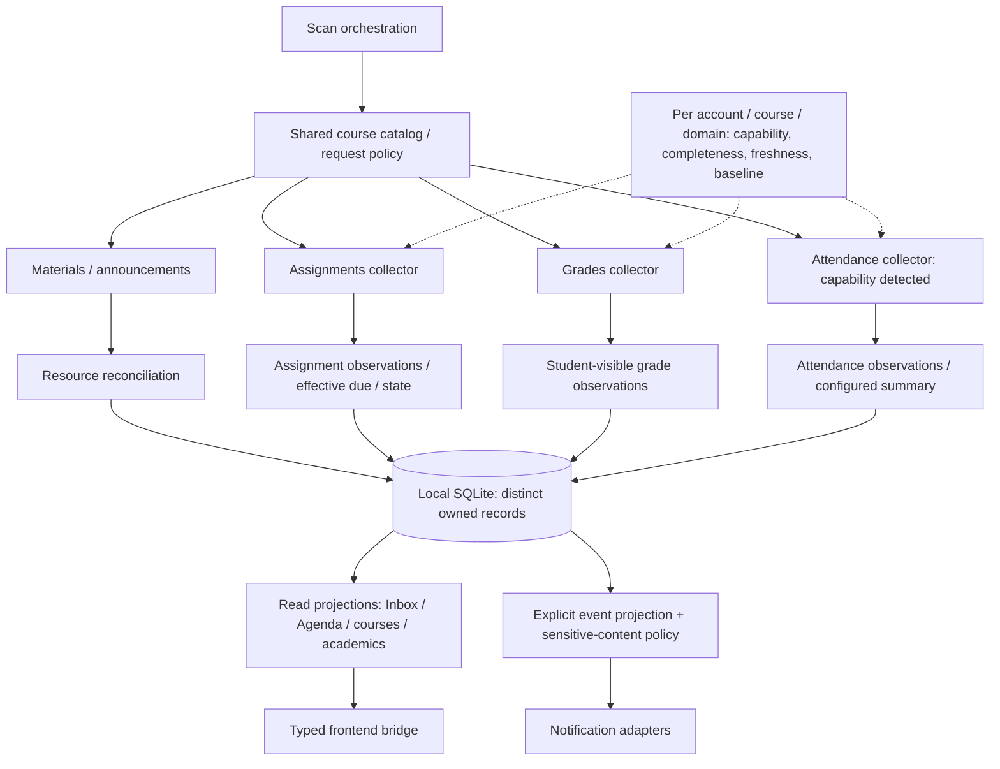

# Backend architecture audit

Audit date: 2026-11-15. Baseline `1bd0e8b5a24b05733295b5751a7bc42de7b90b43`. Read-only source audit; no application, schema, test or decision-record edits. This is a planning assessment, not an implementation specification. Line references below are relative to repository root at this baseline.

## Current state and strengths

The app is an in-process desktop modular monolith with local SQLite. The topology fits its local-only purpose; adding grades does not justify splitting into network processes.

- `sync/scheduler.rs` checks due time on a 30-second tick; scans default to hourly. Auth expiry parks scheduling. `engine.rs:25` prevents overlapping scans and participates in session-reset coordination.
- `quanta/discover.rs` lists courses, traverses nested course pages, then performs announcement/material detail reads. Bounded course/resource/detail counts and a semaphore already limit workload. `parse.rs` and `urlnorm.rs` are pure, tested logic.
- `engine.rs:75` combines Tauri state, discovery, resource writes, pure diff decisions, event construction, baseline/miss rules, mirror enqueueing, scan status and notifications. This is the largest correctness seam to deepen after collection organization.
- `db.rs` opens WAL SQLite with foreign keys and a busy timeout, takes consistent SQLite backups before recognized upgrades, and owns parameterized queries. `attention.rs` is already a useful deep module: complete Inbox/Due matching, consistent counts/snapshots, explicit atomic acknowledgment/dismissal, tested using real temporary SQLite.
- `core/mirror.rs` is already decoupled from Tauri through `MirrorCtx`, persists a queue, streams downloads with size/stall controls, resumes conditionally, hashes bytes and retains versions. It releases its DB lock before network awaits. Its size alone is not evidence that it should be fragmented.
- `core/files.rs` is an evictable preview cache; `core/mirror.rs` is the retained user mirror. Their different retention contracts are deliberate, not duplicate storage to combine casually. `core/text.rs` reads local text without network, while `core/search.rs` shares resource title/course lookup.
- `tests/session_expiry.rs:10` exercises real discovery through a loopback HTTP fixture, a valuable existing collection seam. Parser tests alone cannot prove their production wiring.

## Findings

Severity is relative to the desktop app: High = correctness/recovery should be addressed before significant expansion; Medium = expansion/performance/failure-mode risk; Low = observability or organization concern. A source-confirmed failure path is not a claim that an end user has experienced data loss.

### B1 — Scan persistence errors can still finalize as successful and consume baseline

**High; conditional failure-path defect; high source confidence; not failure-injection reproduced.**

Evidence: `src-tauri/src/sync/engine.rs:253` catches a failed resource write and continues; `:366` catches transaction commit failure and appends `outcome.errors`; `:395` sets `baseline_established` using only discovery success; `:401` consumes rebaseline markers even if persistence failed; `:411–437` computes persisted status and clears `last_error` using discovery errors, ignoring later persistence errors. Missing-resource bumps and mirror enqueueing also execute after the failed commit path.

Trigger: discovery succeeds but a resource/event write or commit fails (for example an injected SQLite failure). The engine can store status `ok` despite `outcome.errors`, clear visible failure state, and attempt to establish/consume a baseline after incomplete persistence. If later marker writes succeed while inventory was not fully persisted, the next scan can report old records as new. No observed production data loss is established.

Proposal: deepen resource reconciliation so it owns the write transaction, final durable outcome, baseline marker and eligible missing-resource changes. Return explicit commit success/failure before external delivery, mirror enqueueing or health publication. Decide intentionally which rows can be partially persisted; do not let exception handling define it accidentally. Keep the pure diff logic internal or reused; moving it alone adds no depth.

Verification: temporary SQLite with failing trigger/resource write and a commit-failure scenario; assert no `ok`, no baseline consumption, no uncommitted event counts/delivery, and correct retry behavior. Preserve quiet first scan, paused/rebaseline semantics, `MISS_THRESHOLD = 2`, source vs detection timestamps and Agenda's no-inferred-completion contract.

### B2 — Truncation and lost detail tasks can masquerade as complete discovery

**High; source-confirmed conditional completeness defects; high confidence; not runtime reproduced.**

Evidence: `src-tauri/src/quanta/discover.rs:257` breaks when resource count reaches the per-course cap; `:268` reports truncation only when `pending` is nonempty. A single page with more resources than the cap and no extra pagination can therefore omit resources with no error. The page-limit check at `:194` pops a page before breaking, which similarly makes queue emptiness an unreliable completeness signal. Detail task completion at `:442` handles only `Ok`; a JoinSet task panic/error is silently ignored, unlike the explicit course-task error branch at `:300`. `sync/engine.rs:310` trusts global error emptiness before treating unobserved IDs as misses.

Trigger: an oversized one-page course, or a failed detail task. Previously stored records can be absent from a result labeled complete; repeated scans may mark them unavailable after two misses.

Proposal: collection must own completeness explicitly, recording cap/task failures independent of queue contents and retaining enough target identity to preserve a failed item's last observation. Later academic expansion needs completion per course/domain, not one global `errors` list. Avoid deriving correctness from diagnostic string prefixes (`engine.rs:356`).

Verification: HTTP fixture with cap+1 activities on a single page; cap reached on final queue page; controlled failed detail task; assert partial status, retained identity and no false miss-streak advancement. Preserve existing limits rather than raising them to conceal the issue.

### B3 — Pre-migration backup detection uses lexical version order

**High for upgrade safety; confirmed algorithmic defect; high confidence.**

Evidence: `src-tauri/src/db.rs:56` compares `app_version > v.as_str()`. A semantic upgrade such as `0.9.0` to `0.10.0` sorts in the opposite order lexically, skipping the backup even though `migrate()` still runs at `:66`. Existing tests starting at `db.rs:1662` cover ordinary `0.1.0` to `0.2.0`, not numeric-width transitions.

Proposal: keep backup/migration ownership in one deep database-upgrade module; compare semantic versions or use an explicit schema migration sequence. Define downgrade/unknown-version handling separately and never silently treat a schema change as safe because an app version string compares lower.

Verification: file-backed temporary DB upgrade tests for `0.9.0→0.10.0`, `0.2.9→0.2.10`, same version, downgrade, unknown and malformed version. Verify backup precedes mutation and original rows survive restore. This is a narrowly fixable defect; it does not require replacing SQLite.

### B4 — Ordinary HTML reads have no byte cap and may consume binary material bodies

**Medium; boundedness/performance risk confirmed in source; no measured memory failure.**

Evidence: `src-tauri/src/quanta/client.rs:256–259` calls `resp.text()` without a body limit. Material detail reads at `quanta/discover.rs:354` use this method, then parse file HTML without first using `Fetched::is_html()` or content type to reject binary bodies. File links can resolve to direct uploads. In contrast `client.rs:283` has bounded byte reads and mirror streaming already enforces explicit limits.

Trigger: a large HTML response or a material URL/redirect that returns a large PDF/video body. Each of the concurrent detail requests can buffer/decode a whole response, independently of the mirror's configured download cap.

Proposal: the request-reading module should own bounded HTML buffering, content-type expectations and an explicit oversized/non-HTML observation. Material collection can retain metadata/source identity and leave binary transfer to the existing streaming mirror adapter. Reuse existing bounded-read techniques; do not add another transport abstraction.

Verification: loopback responses with large Content-Length, chunked over-limit HTML, unexpected PDF, legitimate HTML with missing content type and login markup. Assert cancellation/ceiling and no false empty-success inventory. Do not infer a measured leak or attacker exploit from this audit.

### B5 — Content-specific collection knowledge is spread through discovery and parser interfaces

**Medium; architectural friction; high confidence; best first structural refactor.**

Evidence: `quanta/discover.rs:317` dispatches detail targets, `:361` branches on announcements, `:380` expands/enriches files, `:442` interprets replacements and `:469` merges results; `parse.rs:557` has an activity-date parser with tests but no production caller. `quanta/mod.rs:26` models only discovered resource metadata.

Proposal: concentrate fetching, parsing and interpretation for existing announcements and materials in focused deep collection modules. Keep course traversal, request budgets, cancellation and shared identity rules explicit. The interface should be the collection test surface: one fixture can assert outgoing requests and resulting observations. Deletion test: deleting the deep module would redistribute kind-specific behavior into discovery; merely moving parse functions into smaller files would only relocate complexity.

For Phase B, add assignments/grades/attendance as typed domain observations with independent freshness, capability/completeness and baselines. An assignment may remain linked to an existing resource; grade items and attendance sessions are not materials with many optional fields. A runtime plugin registry, future token adapter and universal academic record are hypothetical seams today.

Verification: positive end-to-end collection fixtures for forum replacement, folder expansion, source-page/section preservation and assignment detail wiring. Keep existing parser tests that cover independent normalization; avoid tests tied to internal helper placement.

### B6 — Complete read collections and per-hit disk checks will grow with retained history

**Medium; scalability risk, not a measured latency regression; high source confidence.**

Evidence: `attention.rs:104–128` loads all eligible change events and `:46` sorts/groups them before filtering/pagination; `:257` loads all resources for Due matching. Commands hold the single shared SQLite connection (`state.rs:150`) for the operation. `core/search.rs:35–58` performs resource lookup and then local-copy lookup/file metadata checks per hit while the caller still holds the connection. The current implementation intentionally guarantees complete counts and frozen bulk scopes.

Proposal: retain these correctness semantics and benchmark representative history sizes before changing them. Then concentrate matching/count/pagination in the same attention module but push safe relational filtering/grouping to indexed SQL; batch local-copy metadata and perform non-DB filesystem checks outside the connection lock where practical. Keep one SQLite database; a connection pool or search engine is not currently justified by evidence.

Verification: compare old/new complete results, stable ordering, counts and frozen snapshot IDs on 5k/25k/100k synthetic histories; record wall time, lock hold time and allocation trends. Verify new events cannot join an already captured acknowledgment scope. This is a later optimization after correctness/collection ownership.

### B7 — Mirror event forwarding terminates permanently on broadcast lag

**Medium; conditional event-delivery defect; high source confidence; not stress reproduced.**

Evidence: `core/mirror.rs:176` creates `broadcast::channel(64)`; `src-tauri/src/mirror_worker.rs:41` receives with `while let Ok(event) = events.recv().await`. Tokio broadcast can return `Lagged` if the receiver falls behind. That exits the forwarder task as if the channel closed, while the worker can keep downloading. UI event updates then cease for the rest of the process lifetime.

Proposal: the delivery adapter should distinguish lag from closure, continue after lag and publish/invalidate a fresh snapshot to recover missed state. Keep progress events as hints over authoritative local state rather than guaranteed exactly-once records.

Verification: overflow a small test broadcast channel, assert forwarding resumes for a later event and produces a recoverable fresh-state signal. No change to download/retention behavior is needed.

### B8 — DB and filesystem failures sometimes collapse to valid empty search/state

**Low-to-Medium; failure visibility risk; high confidence.**

Evidence: `core/search.rs:45` turns query errors into no hits; mirror stats and queue operations at `core/mirror.rs:367–411` default DB errors to zeros, and cache deletion/eviction at `core/files.rs:86–121` ignores unlink/index failures while returning a removed count. Many of these are reasonable best-effort paths individually, but the interface does not tell callers whether “empty” means valid absence or failed lookup.

Proposal: classify authoritative query/mutation failures separately from optional cosmetic metadata updates. Deep modules should expose truthful partial/failed outcomes, with errors recorded once at the owning seam. Do not mechanically replace every `unwrap_or_default` or ignored result: cache access-time touches can remain best effort; grade emptiness and destructive cleanup cannot.

Verification: closed/corrupt schema or injected permission failures in temporary fixtures; search reports unavailable instead of zero hits; cleanup reports actual failures and does not claim released disk space when unlink fails. Preserve offline-cache self-healing and retained mirror files.

## Proposed organization and stages

Phase A: deepen existing behavior first. Keep `sync/scheduler` and a thin Tauri scan adapter; move current material/announcement collection ownership under `quanta/collection/`; move resource persistence/reconciliation into a deep local module. Keep parsers private to their relevant collection when possible, with shared URL/date/identity helpers where real reuse exists. Keep the existing client, SQLite and mirror adapters. Fix confirmed failure paths in separately tested changes, because they intentionally change behavior.

Phase B: after signed-in evidence, add assignment observation collection/storage/projection, then grade observations, then optional attendance. Each domain owns semantic identity and a successful-first-collection baseline scoped to account/course/domain. Report permission denial must not mark unrelated uploads missing; failure retains previous academic observations as stale. Keep academic change projection separate from Telegram content delivery. No live page fetching/marking is authorized by this read-only audit.

Suggested conceptual tree (organization only, not finalized interface design):

```
src-tauri/src/
  quanta/
    client.rs, urlnorm.rs
    collection/
      courses.rs, materials.rs, announcements.rs
      assignments.rs       # Phase B
      grades.rs            # Phase B
      attendance.rs        # conditional Phase B
  sync/
    scheduler.rs, engine.rs # orchestration/adapters
  resources/
    reconcile.rs           # existing material inventory semantics
  academic/                # Phase B only
    assignments.rs, grades.rs, attendance.rs
  db/                      # optionally split by owned query sets as touched
    migrations.rs, resources.rs, attention.rs, mirror.rs
  core/mirror/, files.rs, search.rs, text.rs
```

Do not move every file just to match this drawing. Deletion/locality tests decide each move; `attention.rs` and `Mirror` already have substantial depth. No independent process, cloud backend, event bus framework, generic database repository hierarchy, or microservice is justified by present evidence.

## Diagram sources

### Current backend



### Phase A: behavior-preserving deepening, followed by isolated fixes



### Phase B: typed academic expansion



## Coverage and evidence limits

Reviewed source: all `quanta` module files; sync engine/diff/scheduler; main DB initialization/migration, resource/event/cache/mirror query sets and upgrade tests; attention selection/mutation/due paths and test references; state locking; core mirror/files/search/text; mirror worker. Reviewed tests: parser and URL inline suites, discovery helper and session-expiry fixtures, DB upgrade/mutation tests, attention fixture coverage, mirror sink/path/name/backoff tests, core files/search/text tests. No numerical test-coverage percentage is claimed.

Context read: AGENTS.md, domain instructions, wiki index and attention/due contract record, both academic scraping research reports. No GLOSSARY.md or docs/adr was found. Auth credentials, Tauri permissions, Telegram transport security, release signing, frontend state and CI are separately assigned to other auditors and are not certified here.

No authenticated Quanta request or packaged app run occurred. Native Windows PowerShell `cargo check --all-targets` passed in 2m30s using Cargo 1.97.1, CARGO_INCREMENTAL=0 and a fresh temporary target directory. `cargo test --lib` passed: 184 tests, 0 failed, 0 ignored (2m22s cold test compilation; test execution 5.98s). No packaged app, GUI or signed-in Quanta flow ran. These passing existing tests do not reproduce the newly identified failure paths. Static findings B1/B2/B7 are not runtime reproductions; B3 is a directly evident ordering error. Measured lock/memory/performance limits remain unknown.
