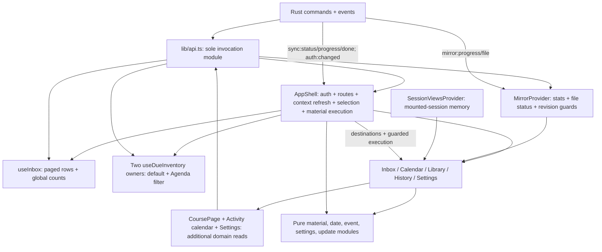
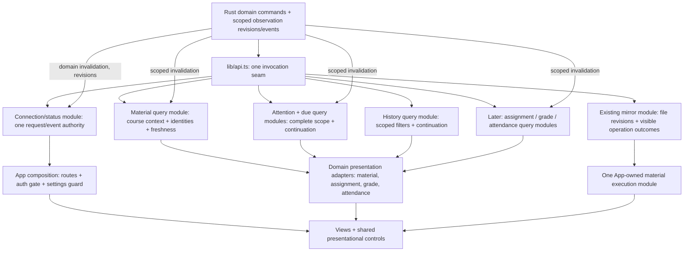

# Frontend architecture and expansion audit

Baseline: `1bd0e8b5a24b05733295b5751a7bc42de7b90b43`. Read-only source audit, 2026-11-15. No application files, tests, glossary, ADRs, branches, or issues changed. This is an evidence-ranked assessment, not a claim of exhaustive dynamic coverage or a native accessibility/security certification.

## Current state and strengths

The frontend is a React desktop client over a single typed Tauri invocation module (`src/lib/api.ts`). `AppShell` owns navigation/authentication gating, course/resource/history context, attention and due collection hooks, the backend event bridge, inspector selection, material execution, settings navigation protection, and update prompts. It supplies data to five navigation destinations: Inbox (`today`), Calendar (Agenda plus Activity calendar), Library, History, and Settings.

`MirrorProvider` is a separate long-lived owner for local-file status/stats and revision-protected file lookups. `SessionViewsProvider` retains navigation/filter/scroll memory for a mounted app session. Views combine presentational controls with some domain reads/mutations. There are already good deep modules: pure material capability policy, date-only/timezone-aware agenda logic, event presentation, settings draft validation, and updater sequencing.

Preserve these strengths:

- All `invoke` calls remain centralized in `src/lib/api.ts`; do not bypass the bridge seam when adding grades.
- Material execution has one intentional owner in App. The shared `MaterialActionsContext` and pure policy prevent rows, menus, and inspector actions drifting. The dated integration decision explicitly establishes this ownership (`docs/wiki/2026-11-14-final-ui-integration.md:7`). Extracting implementation into a hook may help locality, but must not create independent execution owners.
- Inbox mutations capture complete event-ID snapshots before confirmation, use explicit desired read state, and leave later arrivals untouched (`src/views/InboxView.tsx:45`, `tests/appAttention.test.tsx`). Inspection is separate from opening and acknowledgment.
- Inbox row and global-count requests have independent generations/errors; due inventory publishes only after its page loop completes (`src/hooks/useAttention.ts`). Existing late-response and stale-data tests are meaningful assets.
- Mirror lookups track per-file revisions as well as request generations (`src/hooks/useMirror.tsx:83`); previews revoke object URLs and ignore late responses (`src/components/PreviewDialog.tsx:65`).
- CSS already has shared tokens, visible focus, reduced-motion and forced-color rules (`src/styles/base.css:62`, `:169`, `:182`). Radix controls and explicit keyboard/focus restoration are established; a rewrite would risk losing these details.
- TypeScript strictness and the real-App Vitest suites provide useful seams beyond isolated utility testing.

## Findings

### FE-01 — High; confirmed/reproduced: the thirteenth new course can freeze the UI

**Evidence:** `src/lib/courseName.ts:99–107`, especially line 102; called synchronously in render at `src/App.tsx:254–256`. `DOT_COUNT = 12`. After all 12 indices are in `used`, `while (used.has(cursor % DOT_COUNT))` can never terminate for another unassigned course. Twelve stored colors plus one new course has the same problem. Existing tests exercise exactly twelve courses (`tests/courseName.test.ts:96`), missing the exhaustion case.

**Verification:** isolated Node subprocesses transpiled the actual source using the installed TypeScript package. Twelve courses exited 0 with size 12; thirteen hit a 1,500 ms timeout and SIGTERM. Reproduction code is `/tmp/quanta-course-palette-repro.cjs`; no regression test was added to the repo in this audit.

**Proposed change:** make palette assignment explicitly bounded and allow deterministic reuse after the first twelve unique courses. Preserve stored colors. Add meaningful cases for 0/12/13/60 courses and exhausted stored indices.

**Deepening:** keep color/name policy in the course-presentation module; the interface must guarantee termination for the supported course count. Leverage comes from one implementation protecting every course pill and navigation display. This does not require another adapter.

### FE-02 — Medium; code-confirmed race path, native occurrence unverified: status reads lack request authority

**Evidence:** `src/App.tsx:298–311` reads status/auth/settings and applies every completion without a generation or session-identity guard. Its invocations can overlap at bootstrap, `sync:done`, `auth:changed`, manual sync, reconnect, and login (`:313–319`, `:348–358`, `:746–750`). Direct `sync:status` and progress events also write the same sync state. In contrast, broad context refresh already has a generation at `:270`.

**Consequence:** an older response can replace newer authenticated/expired status, settings, or progress. A read started before a save can finish afterward and restore older settings in the UI. This is a concrete ordering possibility, not evidence that it occurred in a native run.

**Proposed change:** deepen the connection/status owner so request authority, current login generation and event freshness are one policy. Tests should resolve two requests out of order and interleave a status event or settings save. Preserve current reconnect/banner semantics and finite updater sequencing.

**Seam:** the current bridge is sufficient; fake/deferred bridge responses are the second test adapter. No global state library is needed for this fix.

### FE-03 — Medium; architectural coupling with code-confirmed failure behavior: broad refresh joins unrelated reads

**Evidence:** `src/App.tsx:271–295` refreshes courses, every resource page, loaded history, scans and DB info in one `Promise.all`; any failure prevents all five snapshots from publishing. App also mounts two due owners (`:114–116`), including when Calendar is inactive; `refreshCollections` refreshes both plus Inbox (`:120`). `CoursePage` fetches course resources/events again whenever root inventory changes (`src/views/library/CoursePage.tsx:147–171`).

**Consequence:** a DB-info/history read failure can retain old course/resource context despite those reads succeeding. Adding optional grades/attendance to this join would couple their permission/layout failures to working Library data. Repeated complete reads create avoidable bridge and derivation work as data grows. This is not a measured performance regression; current tests intentionally cover retained-data behavior.

**Proposed change:** give course/material context, History, connection status and each academic domain separate deep query owners, with explicit freshness/error/pending states and event invalidation. Preserve last successful observations on failure. Share equal due queries or activate filtered ones deliberately. Retain App as composition/navigation/material-action owner; do not replace it with a giant generic store.

**Verification:** fail DB-info or History while allowing material refresh; ensure material context updates and each error is attributed correctly. Count bridge calls for bootstrap, sync completion and a hidden Calendar. Exercise assignment/grade permission failure independently from uploads. Locality improves because each owner carries its own request authority; leverage comes from reusing that owner across view and inspector.

### FE-04 — Medium; consistency/scaling risk, not a demonstrated native defect: page loops do not pin a data revision

**Evidence:** `src/hooks/useAttention.ts:55–68` accumulates due pages by numeric offset and mutable total; `:78–84` accumulates resource pages until a short page. Neither request carries a scan/database revision or cursor snapshot. Due collection catches an empty page before the expected total, but not overlapping/missing non-empty pages after concurrent insertions or sort changes. Inbox deduplicates loaded items by key (`:27`), which does not recover a skipped item.

**Consequence:** successful per-request generation checks protect against old filters, not writes between pages. A scan or mutation during a multi-page load can still produce a mixed observation or duplicates. Requests abandoned by the outer resource refresh also continue fetching until the page loop ends.

**Bounded reproduction:** transpiled actual `useDueInventory` with minimal hook/bridge stand-ins; two non-empty pages `[A,B]` then `[B]`, both reporting total 3, published `[A,B,B]` as a successful result. This verifies the frontend lacks overlap detection. It does not prove that this exact sequence occurred on the native backend.

**Proposed change:** establish complete-query semantics at the query module seam: a stable revision/cursor with retry on change, or one bounded backend snapshot where practical. Avoid claiming snapshot consistency from client page accumulation alone. Return explicit partial/fresh/stale state. Do not universally add pagination infrastructure before defining domain needs.

**Verification:** interleave a persisted write between pages in the backend query tests and delayed bridge pages in frontend tests; assert complete identities without duplication and a bounded restart. Preserve full baseline deadline coverage and totals independent of loaded rows.

### FE-05 — Medium; confirmed reachability limitation: History is capped without an older-page path

**Evidence:** `src-tauri/src/commands.rs:138–140` requests at most **1,000** History events; `src/lib/api.ts:59` exposes no paging parameter; `src/App.tsx:279–280` uses that call and scans default to 50 (`src/lib/api.ts:68`). `HistoryView` filters only received rows (`src/views/HistoryView.tsx:128–147`) while its summary says “Every recorded change and scan” (`:234`). There is no load-more path for older History. `db.rs:779–783` sorts newest first and applies the limit. This is visibility truncation, not database loss.

**Important distinction:** “Mark loaded history read” is accurately labeled (`HistoryView.tsx:244`) and App sends only loaded IDs (`App.tsx:418`). The permanent delete dialog intentionally targets all stored history. Do not conflate either with Inbox, whose complete counts and captured mutation scope are separate and correct. There is no 10,000-event cursor in this inspected History path.

**Proposed change:** deepen a History query module with explicit total/continuation, backend-scoped filters, and bounded display. Show coverage honestly until continuation exists. Verify older matching events beyond the first 1,000 and scans beyond the first 50; preserve capture-based mutation semantics and permanent-delete scope.

### FE-06 — Medium; expansion risk: material capability/inspection vocabulary should not become a universal academic model

**Evidence:** `src/lib/types.ts:20–45` describes Resource with URL/file size/fingerprint/availability; `src/lib/details.ts:20–58` renders Uploaded, File, Preview and local-file facts; `src/lib/materialActions.ts:29–35` derives saved/download actions for internal resources unless local state is unsupported. `App.tsx:515–533` supplies local support primarily from external/source state. `DetailSubject` is presently resource/change/scan (`details.ts:64–68`).

**Consequence:** putting grades or attendance into Resource and reusing these adapters indiscriminately could produce file/download affordances, invented upload meanings, and wrong inspection identity. This is a future-design hazard, not a claim that current production grades are mishandled; grade/attendance records do not exist yet.

**Proposed change:** retain the useful material module and add assignment/grade/attendance domain query/presentation modules. Reuse generic presentational controls and course identity, not material-only semantics. An assignment can reference its existing resource plus attachments; a grade item or attendance observation gets its own domain identity, freshness and supported actions. The shell composes these adapters into inspector/navigation as real domains arrive. Defer a universal entity framework and runtime plugin registry.

**Verification:** a grade cannot request mirror/download actions; missing grade is not zero; unknown submission is not incomplete; no attendance record is not absence; a source link remains available separately from private values. Preserve current material actions and orphan-change behavior. Interface depth and locality come from hiding each domain's interpretation in its module.

### FE-07 — Medium; confirmed failure-handling path: Downloads actions swallow their failures

**Evidence:** `src/hooks/useMirror.tsx:156–175` catches a mutation failure and only awaits refresh, which itself swallows errors (`:117–119`). `DownloadsPopover.tsx:68` and `:95` invoke pause/resume/retry with no visible error state. Thus a rejected user action can resolve normally after a failed/successful refresh with no explanation to the user.

**Proposed change:** deepen the mirror action owner with explicit operation outcomes/pending/error handling, and let the popover render recoverable failure information. Keep background stats refresh best-effort; user-requested writes deserve visible failure. Settings currently has its own `runOperation` error handling around direct calls, so do not blanket-change all mirror reads or duplicate toasts.

**Verification:** reject pause/resume/retry; confirm status remains truthful, errors are visible, retries work, and duplicate activation is bounded. Preserve per-file event/revision reconciliation. No new adapter is needed beyond existing bridge fakes.

### FE-08 — Medium; confirmed cross-seam mismatch, conditional on non-system timezone

**Evidence:** App passes `resolveTimezone(settings?.timezone)` into Calendar. `src/views/ActivityCalendar.tsx:195` groups event dots using that zone, but `:138` calls `eventsRange(from, to)` and `:161` calls `dailyDigest(selected)` without a timezone. Rust uses system-local date conversion in `src-tauri/src/commands.rs:170`, `:221–223`, `:763–777`. The bridge has no zone or explicit UTC-bound arguments for these paths. Agenda's distinct due-date path does support configured-zone semantics; do not generalize its guarantees to Activity calendar.

**Consequence:** with system UTC and configured Asia/Kolkata, an event at `2026-10-31T19:00:00Z` belongs to November 1 in the displayed zone but is excluded by November's system-UTC month range. A selected day's digest can disagree with the displayed-zone grouping. This follows directly from the two conversions; no native occurrence was reproduced. Settings exposes the stored timezone field, although the current Settings screen does not provide an obvious custom-zone selector, limiting immediate reachability.

**Proposed change:** deepen the date-range query seam so bounds and grouping share one explicitly owned timezone interpretation; pass resolved instant bounds or a verified zone through the whole query. Preserve the source distinction between date-only and instant timestamps. Test month/day boundaries with system UTC versus Kolkata and a DST-changing zone. Do not repair this by inventing an offset for date-only deadlines.

## Additional observations below finding threshold

- `registerCourseLabels` is a mutable module registry and persists dot assignments from App's render-time `useMemo` (`App.tsx:254`, `courseName.ts:178–196`). This harms purity and multi-root/account isolation; moving to a session-owned, side-effect-free presentation value is worth doing alongside FE-01 if kept narrow. It is not grounds for a broad state rewrite.
- History and Inbox repeatedly find a resource in the full array (`HistoryView.tsx:333`, `InboxView.tsx:98`), while Activity calendar already creates a resource-ID map (`ActivityCalendar.tsx:130`). Reuse a memoized index if measured list growth justifies it. No latency claim is made from asymptotic inspection alone.
- The root 30-second clock rerenders its mounted subtree and current palette matching is in-memory. Keep future grade/attendance queries off this clock and benchmark before adding caches/workers.
- Current typed bridge responses are compile-time promises, not runtime schema validation. Rust/TS contract drift deserves serialization/bridge tests as domains are added; code generation is optional and must earn its maintenance cost.

## Current ownership diagram

## Proposed organization diagram (direction, not fixed interfaces)

Interpretation: keep existing React/Tauri/local-only deployment. Begin by fixing the palette defect and status authority. Extract established query responsibilities incrementally, preserving current owners and tests. Add one academic domain at a time; only generalize after repeated real behavior establishes a seam. No migration to a global store, router, remote backend, or query framework is justified by this audit alone.

## Coverage and limits

Reviewed source ownership and representative implementations across App/main, all hook modules, bridge/types, course/material/detail/date/event/settings/update logic, all navigation view families, shared rows/tables/dialog/preview/palette/download controls, token/style/accessibility structure, and representative real-App/logic tests. Read the domain instructions, wiki index and dated integration/attention decisions. Searched source-wide for direct invocation, mutable globals, query/mutation/error patterns, styles and broad assertions.

Not every line of every visual primitive was deeply inspected. No native app, live signed-in Quanta flow, screen reader, full visual matrix, package installation or external dependency vulnerability database was exercised. Backend query behavior was read only where necessary to establish the frontend's actual caps and consistency seam; other agents own backend/security/release review. This is not a claim of zero defects elsewhere.

## Validation performed

- Isolated actual-source palette reproduction: 12 courses pass; 13 courses time out (confirmed).
- `npm run lint`: passed, exit 0, zero warnings.
- `npm test -- --maxWorkers=2 --minWorkers=1`: passed, exit 0; **50 test files / 492 tests**. Duration 857.48 seconds on this mounted checkout, with substantial collection/environment time. This is test-run timing, not application performance. No repeat run was started.
- `npm run build`: passed, exit 0; TypeScript completed and Vite transformed 2,107 modules. Existing main-chunk size advisory remains (523.12 kB minified, 166.07 kB gzip). Vite phase took 4m 26s on this checkout/host; this is build time, not application startup or interaction latency.

No repository test/code changes were made. Existing generated `dist/` output may be refreshed by the requested build, as expected; no packaged application was executed.

The test output includes nonfatal jsdom canvas `getContext` diagnostics from axe, React `act()`/overlapping-`act()` warnings from Settings About and Calendar keyboard tests, and a Node child-process shell deprecation diagnostic in release fixture tests. Version/release fixture tests also intentionally print negative-case failures and temporary-repository branch messages; those suites pass. These diagnostics limit what a clean test summary alone establishes about rendering/accessibility and async test discipline. No dependencies were installed to suppress them.
