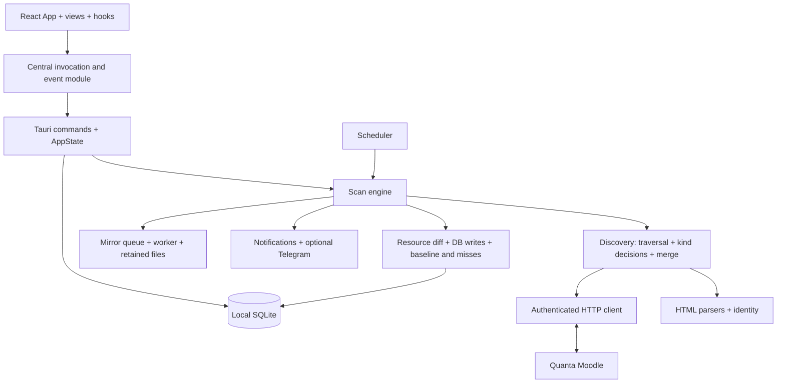
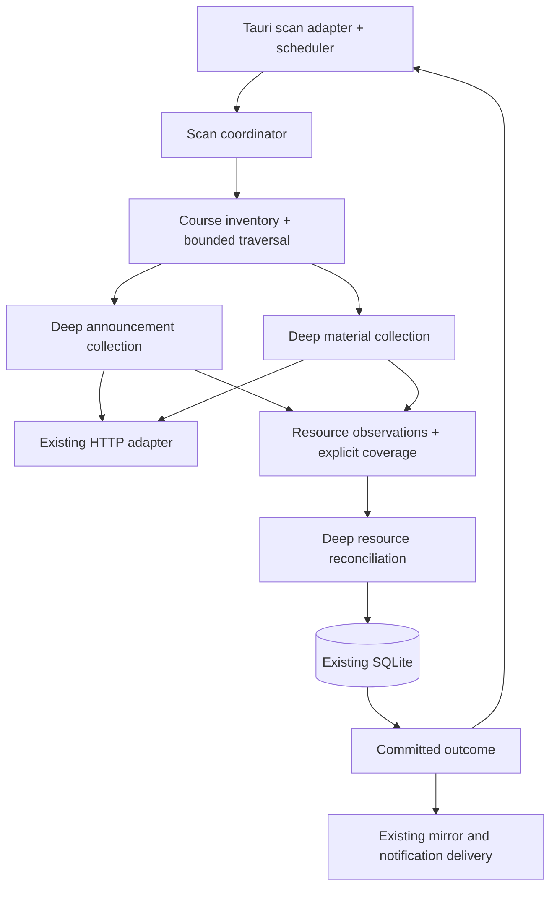
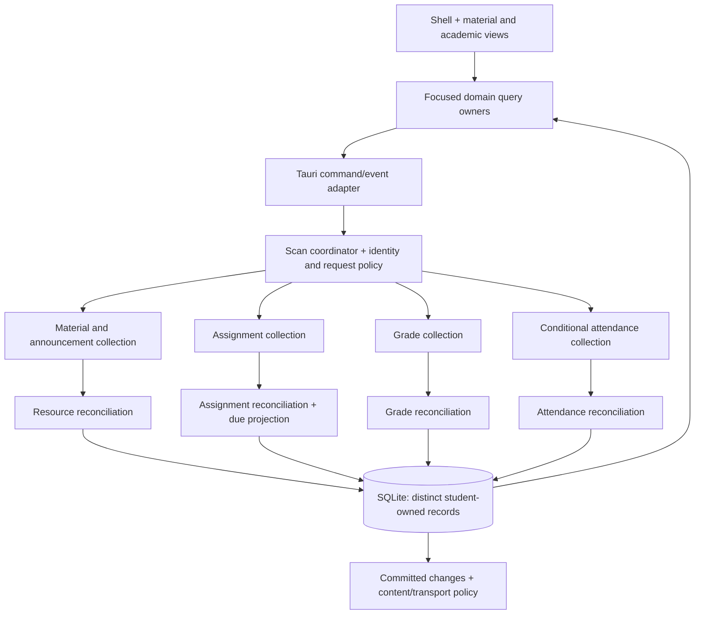

# Quanta Pulse: codebase audit and expansion architecture

Date: 2026-11-15. Source baseline: `1bd0e8b5a24b05733295b5751a7bc42de7b90b43`. Three independent subagent audits cover backend collection/persistence, frontend ownership, and safety/operations. This document reconciles their findings. It is an audit and proposed plan, not an implementation specification, release approval, or security certification. No application code was changed.

## Assessment

**Keep the existing local desktop architecture. Fix correctness defects, then deepen collection and reconciliation before adding personal academic records.** The stack and deployment model fit the product. The main scaling problem is distributed responsibility: a new domain would currently touch discovery, resource fingerprints, transaction rules, global baselines, root refresh state, inspectors, and notification handling.

The selected first structural change—collection ownership—is well supported. A focused announcement or material collection module should own its requests, parsing, enrichment and interpretation. Shared traversal, budgets, cancellation and identity rules remain shared. Moving parser functions into smaller files alone would not create depth.

The audit also found actionable defects beyond organization. One is dynamically reproduced: **a thirteenth course can freeze the frontend**. Other high-priority findings are source-confirmed conditional failure paths, not observed production incidents. Baseline checks can pass while these cases remain untested.

“Scalable” here means more courses, retained history, source formats and academic domains within one student's desktop workspace. It does not imply a new server, a distributed deployment, or unlimited polling.

## 1. Current architecture

### Ownership and flow

| Area | Current owner | What is already good | Main pressure |
| --- | --- | --- | --- |
| Desktop shell | `lib.rs`, command handlers, `AppState` | Explicit command registration; centralized shared state | Lifecycle admission and state publication differ between operations |
| Frontend | `App.tsx`, hooks, views, pure `src/lib/` modules | One invocation module; intentional material-action owner; real-App tests | Broad refresh joins unrelated reads; status freshness has a separate weaker policy |
| Collection | `quanta/discover.rs`, `parse.rs`, `client.rs`, `urlnorm.rs` | Bounded traversal/concurrency; pure parsing; loopback HTTP tests | Kind-specific request, replacement and merge decisions live in orchestration |
| Reconciliation | `sync/engine.rs`, `diff.rs`, `db.rs` | Pure resource comparison; quiet baseline; repeated-miss rule | Durable outcome, baseline, partial coverage and effects are coordinated in one Tauri-aware function |
| Local queries | `db.rs`, `attention.rs`, search modules | SQLite, parameterized queries; complete attention counts and captured mutation scopes | Several reads materialize complete collections; History has a separate hard cap |
| Local files | preview cache, mirror module and worker | Streaming/resume, size limits, persistent queue, retention/path protections | Ordinary HTML detail reads bypass binary-transfer boundedness; event lag recovery is weak |
| External effects | authentication, native notifications, optional Telegram, updater | Session cookies in process memory; Telegram opt-in; signed-update configuration | Per-transport delivery state, secret preferences and lifecycle admission need clearer ownership |

The scheduler checks the stored due time approximately every 30 seconds; scans default to **60 minutes**, with a configured minimum of 15 minutes. This is not a 30-second scraping cadence. See [scheduler](../../src-tauri/src/sync/scheduler.rs) and [settings](../../src-tauri/src/settings.rs).



The [full current diagram](2026-11-15-architecture/current.mmd) also shows preview reads, authentication, worker networking, and update paths. Manual update operations use the updater/process plugins through `src/lib/api.ts`; the custom command handles preparation. Telegram has an independent HTTP client; mirror downloads use the Quanta session client.

### Existing depth to preserve

- The attention module owns consistent list/count/filter semantics and complete captured event-ID scopes. A bulk acknowledgment must never include events that arrive after capture.
- Material action policy and the single App execution owner prevent row/menu/inspector drift. Extracting implementation must not create competing owners.
- Date-only values and instant/timezone-aware deadlines remain distinct. Agenda deliberately does not infer submission completion.
- Mirror storage and evictable preview cache have different retention contracts. Their coexistence is intentional.
- Session reset already has cancellation, admission gating and draining. Reuse its lessons rather than replacing it with scattered flags.
- Existing path protection, readable-text previews, bounded binary previews, login-token handling and secret-log redaction are useful safeguards. No reason was found to discard them in a rewrite.

## 2. Prioritized findings

Priority is about remediation order, not a vulnerability score. **High** means current correctness/recovery or a prerequisite to storing personal academic records. **Medium** means a concrete reliability limitation or expansion risk. “Source-confirmed” establishes the code path; it does not establish a production incident.

| ID | Priority / evidence | Finding and consequence | Primary location |
| --- | --- | --- | --- |
| A01 | High; reproduced | A 12-color uniqueness loop cannot allocate a thirteenth course; synchronous registration can freeze render. | `src/lib/courseName.ts:102`, `src/App.tsx:254` |
| A02 | High; conditional failure path | Resource/event/commit failures enter `outcome.errors`, but baseline consumption and persisted scan success use discovery errors. Incomplete persistence can be presented as success. | `sync/engine.rs:253`, `:366`, `:395`, `:411` |
| A03 | High; conditional completeness defect | A resource cap on a single page can omit records without marking traversal partial; detail task join failures are ignored. Repeated partial scans can advance false misses. | `quanta/discover.rs:257`, `:268`, `:442` |
| A04 | High before personal records; confirmed defect | Session verification enriches a local session copy after constructing the client; the published SSO client retains missing verified identity/key/name metadata. | `auth.rs:283`, `:297`, `:318` |
| A05 | High before migrations; confirmed algorithm defect | Lexical version comparison can skip backup for an upgrade such as `0.9.0 → 0.10.0`, while migration still runs. | `db.rs:56` |
| A06 | High expansion gate; missing model, runtime mixing unverified | Persistent records have no student ownership, and normal logout does not fence/drain cloned clients like reset does. New personal records could be mixed across account changes. | `state.rs:123`, `auth.rs:348`, schema, `engine.rs:103` |
| A07 | High before optional reports; existing behavior | HTTP 403 means expired authentication, causing a scan-wide stop. A denied optional report needs distinct interpretation supported by source evidence. | `quanta/client.rs:246`, `tests/session_expiry.rs:94` |
| A08 | Medium; boundedness risk | HTML fetch buffers unlimited text; detail collection can fetch direct binary material bodies using that path. Memory failure was not measured. | `quanta/client.rs:256`, `discover.rs:354` |
| A09 | Medium; source-confirmed ordering possibility | Unguarded status/auth/settings reads can overwrite newer responses or events. Native occurrence was not reproduced. | `src/App.tsx:298` |
| A10 | Medium; confirmed coupling | One root `Promise.all` couples courses/resources/history/scans/DB info; unrelated failures block publication. Two due owners and course-local reads repeat work. | `src/App.tsx:114`, `:271`; `CoursePage.tsx:147` |
| A11 | Medium; mixed-revision risk | Offset page loops do not pin a database revision. Writes between pages can duplicate or skip records despite frontend request generations. | `src/hooks/useAttention.ts:55`, `:78` |
| A12 | Medium; confirmed reachability limit | History exposes the latest 1,000 events and defaults to 50 scans with no older-page path, despite claiming all recorded history. Records are not deleted. | `commands.rs:138`, `api.ts:59`, `HistoryView.tsx:234` |
| A13 | Medium; conditional delivery defect | Mirror broadcast lag exits the forwarding task permanently because any receive error ends the loop. | `mirror_worker.rs:43`, `core/mirror.rs:176` |
| A14 | Medium; conditional delivery defect | Telegram events are marked notified before asynchronous delivery succeeds; a later failure has no durable retry acknowledgment. | `notify.rs:94`, `telegram_worker.rs:194` |
| A15 | Medium; confirmed exposure surface | Telegram token is serialized in ordinary settings, returned to the renderer and included in DB backups. No unauthorized read was demonstrated. | `settings.rs:62`, `db.rs:347`, `commands.rs:321` |
| A16 | Medium; lifecycle race risk | Update preparation waits for idle without holding admission closed through installation; new work can be admitted afterward. No installed-update race was reproduced. | `commands.rs:1114`, `sync/engine.rs:25` |
| A17 | Medium; failure visibility | User mirror actions swallow failures; several authoritative backend lookups default errors to empty/zero. Cosmetic best-effort writes need different treatment. | `useMirror.tsx:156`, `core/search.rs:45` |
| A18 | Medium; operational gap | Release workflow checks main ancestry/version/config but has no explicit dependency on green CI for that exact tagged SHA. Repository protections were not inspected. | `.github/workflows/release.yml:30`, `ci.yml:3` |
| A19 | Medium; conditional configured-timezone mismatch | Activity calendar groups with configured timezone, but its range/digest commands use system-local date bounds. An event near midnight can fall outside the displayed month's query. Current custom-zone UI reachability is limited; no native reproduction. | `ActivityCalendar.tsx:138`, `:161`, `:195`; `commands.rs:170`, `:764` |

Detailed mechanisms, further source locations and proposed regression tests are in the [backend audit](2026-11-15-architecture/backend-audit.md), [frontend audit](2026-11-15-architecture/frontend-audit.md), and [safety/operations audit](2026-11-15-architecture/safety-audit.md). All line references refer to the baseline commit, not a later moved file.

### What the reproduced case proves

The frontend auditor transpiled the actual `courseName.ts` into an isolated subprocess: 12 courses completed successfully; 13 timed out after 1,500 ms and were terminated. This demonstrates nontermination under that input, not a native-window recording. The existing palette test reaches exactly 12. A narrow fix should bound allocation and reuse colors deterministically, preserving previous assignments; test 0/12/13/60 courses and exhausted stored colors.

A separate synthetic actual-hook probe supplied overlapping resource pages and observed `[A, B, B]` published as a successful inventory. This confirms that frontend accumulation does not detect that overlap; it does not reproduce a native concurrent database write. Database revision consistency remains a separate proof obligation.

### What to fix without a redesign

A01, A04 and A05 have narrow responsible owners. Fix them independently, with failing regressions. A02/A03 require explicit successful persistence and collection coverage; do not hide those behavior fixes in file moves. A13/A14 need truthful delivery outcomes, not more collection abstractions.

The audit does **not** recommend deleting every ignored result or `unwrap_or_default`. Cache access-time touches can be best effort; failed authoritative reads, user mutations and baseline commits cannot truthfully become empty success.

## 3. Proposed architecture A: deepen existing behavior

This is the recommended first structural direction. It preserves deployment, storage technology and student-visible material behavior.



[Full proposed refactor diagram](2026-11-15-architecture/refactor.mmd).

### Collection ownership

The announcement collection module owns forum reads, discussion observations and container replacement. The material collection module owns file/folder reads, enrichment, expansion, source-page attribution and replacement. Course inventory/traversal owns visited pages, shared request budgets and cancellation.

The **interface is the test surface**: collection tests must verify requests and resulting observations together. Existing loopback HTTP fixtures already supply a real test seam. There is no need to introduce a runtime plugin registry or a second transport implementation. The production HTTP adapter and synthetic local responses are enough to verify the behavior now.

**Depth/deletion test:** removing the collection module should scatter kind-specific request/parse/merge knowledge back into callers. If removing a new module only removes forwarding calls, it was shallow and should not be added.

### Resource reconciliation ownership

A resource reconciliation module owns write ordering, diff interpretation, event deduplication, baseline establishment/consumption and eligible miss handling. It produces a durable result before effects are dispatched. The scan coordinator retains scheduling/lifecycle/progress concerns; it does not encode material absence or grade meaning.

Keep temporary SQLite as the test setup. A fake database adapter and generic repository hierarchy are not needed. Preserve the pure diff implementation where it supplies useful logic; do not multiply public interfaces just to retain the current file layout.

### Frontend query ownership

Keep App as composition, navigation, auth gate, dirty-settings guard and intentional material-action execution owner. Deepen focused owners for connection status, course/material context and History. Retain the already useful attention/due and mirror modules, fixing their specific gaps.

Each query owner controls request authority, freshness, error attribution and invalidation. Adding a forbidden grade report must not prevent successfully refreshed material data from publishing. Reuse equal due queries or activate filtered queries deliberately. A global state/query framework is not required by the evidence.

### Proposed organization, not compulsory file moves

```text
src-tauri/src/
  quanta/
    client.rs, urlnorm.rs
    collection/
      courses.rs, announcements.rs, materials.rs
      # parser implementation colocated by responsibility;
      # shared helpers only for actual reuse
  sync/
    scheduler.rs, engine.rs       # coordination and Tauri adapter
  resources/
    reconcile.rs                 # material inventory correctness
  attention.rs                   # retain existing depth
  core/mirror/, core/files.rs    # retained vs evictable copies
  db.rs                          # split owned query sets only as touched

src/
  App.tsx                        # composition and intentional owners
  lib/api.ts                     # sole invocation module
  hooks/                         # focused connection/query/action owners
  lib/                           # pure domain policy
  views/, components/            # domain views, reusable controls
```

This tree is an organization proposal, not final interface design. File count and file size are not acceptance criteria. **Locality** means a collection change and its verification concentrate in one owner. **Leverage** means callers gain complete behavior without learning request ordering and reconciliation rules.

## 4. Proposed architecture B: academic expansion

Build this incrementally after architecture A and the identity/safety gates. Do not pre-create empty assignment/grade/attendance modules.



[Full academic expansion diagram](2026-11-15-architecture/academic-expansion.mmd).

### Keep domains distinct

- **Materials/announcements:** existing resource identity, availability, mirror eligibility and history.
- **Assignments:** effective dates, submission/attempt/team state and released feedback; may reference an existing resource and attachments. A due projection can feed Agenda without pretending that a submission is a file download.
- **Grades:** student-visible item/category identity, raw display values, released feedback and authoritative reported totals. Missing/hidden/unknown is not zero. Do not calculate institutional CGPA from visible marks without a separate supported rule.
- **Attendance:** detected own report, source-specific session identity when available, configured status/points and correctly scoped summary. An unmarked or future session is not absence. Weak HTML identity may limit change tracking to snapshots/summaries.

Each domain carries verified student ownership, source/course identity, observation time, last successful collection, freshness/capability state and a quiet first-success baseline. Collection failure must preserve an old observation as stale rather than write a new empty truth. Visibility loss must not be presented as a freshly confirmed old mark.

Reuse course identity, presentational controls and source opening where the behavior is actually shared. Do not reuse file/download/preview adapters for grade rows. Introduce an academic query/presentation module only when the corresponding domain ships; do not build a universal entity or plugin framework.

### Collection completeness is a correctness fact

Track success/partial/failure by course and domain, with explicit reasons for caps, denial, parse mismatch and task failure. Human-readable error strings are diagnostics, not the sole control plane. A denied attendance report must not advance missing-upload streaks or consume a grade baseline.

The current global behavior should first be preserved during extraction. Introducing more granular reconciliation is an intentional, tested behavior change afterward.

## 5. Safety and recovery requirements

| Concern | Required rule before expansion | Proof to collect |
| --- | --- | --- |
| Student ownership | Choose a single verified-student workspace with explicit switching, or separate student workspaces. Both must fence stale work; multi-account UI is not required. | Delayed A request/scan cannot publish/write into B after logout/login; restart and failed switch tests |
| Session publication | Publish only the verified session/client, including self ID and current session facts. | Synthetic SSO verification asserts stored state, not just parser output |
| Request intent | Own allowed routes, expected response kind, body ceilings, redirects and optional-report denial centrally. Preserve legitimate file redirects deliberately. | Login/denial/non-HTML/oversized/redirect fixture cases |
| Collection effects | GET is not a zero-effect guarantee. Assignment views affect completion; Attendance self-mark/mobile paths can mark records; course-log automarking may react to reads. Quanta settings remain unverified. | Installed-version and policy evidence before unattended academic polling |
| Persistence | Baselines, counts and effects depend on a successful durable result; migration backup precedes mutation. | Temporary DB failure injection, semantic-version edge cases, restore/rollback tests |
| Data semantics | Unknown is distinct from empty, hidden, zero, unsubmitted or absent. | Domain fixtures for every supported state and visibility transition |
| Privacy | Academic values stay out of generic diagnostics and notification text by default; external forwarding is explicit per destination. | Payload assertions across native and Telegram paths; synthetic fixtures contain no personal records/tokens |
| Secrets | Separate configured-status preferences from secret values; migration/recovery must preserve functioning credentials. | Renderer redaction, secret-store unavailable, clear/restore and backup handling tests |
| Delivery | Progress events are recoverable hints; external delivery success is tracked per transport if retry reliability is promised. | Broadcast overflow recovery; failed send/restart/duplicate retry scenarios |
| Lifecycle | Reset/install/shutdown need defined admission and drain ownership; failure must release gates and preserve monitoring. | New work racing final idle check, cancelled/failed install, restart tests |
| Desktop trust | Review main-window capabilities and add a tested content policy before expanding powerful commands. Disabled CSP is a hardening observation, not a demonstrated exploit. | Native preview/bridge/SSO checks; no assumption that remote SSO has main-window privileges |
| Release | Publishable builds should have same-SHA verification, signed artifacts and supported-platform evidence. | Required CI identity, version/config checks, targeted native smoke; live signature/install verification separately |

The current app is local-first with **optional Telegram sharing**. Its source does not support an absolute no-egress claim. Native notification text and Telegram currently share a presentation function; new academic event types must not join that path without a deliberate content rule.

Academic source evidence is detailed in the [scraping expansion report](2026-11-15-academic-scraping-expansion.md) and [pinned upstream inventory](2026-11-15-moodle-academic-data-sources.md). No live authenticated Quanta validation was performed for this audit.

## 6. Scaling strategy

1. **Correctness before larger limits.** Fix collection coverage and durable scan outcome; raising caps can conceal false completeness. Keep bounded requests and the present scan interval until measured demand justifies a change.
2. **One shared workload budget.** Coordinate domain request counts/concurrency/cancellation; expose per-domain partial coverage. A material detail cap must not silently starve academic collection. Capability-denied outcomes need bounded retry policies, not repeated polling or permanent caching of transient failures.
3. **Coherent reads.** Define revision/cursor or bounded-snapshot semantics for complete page loads. Request generations protect UI authority, not database consistency between pages. History needs explicit continuation and truthful scope.
4. **Measure local costs.** Attention currently materializes and groups full collections; some search paths check disk metadata per hit under the shared connection. Benchmark synthetic 5k/25k/100k retained histories, lock hold time and memory before changing queries. These are proposed workloads, not measured performance claims.
5. **Optimize within proven modules.** Push safe filtering/grouping to indexed SQL, batch metadata, and move non-DB filesystem work outside the connection lock where practical. Preserve counts, ordering and captured mutation scopes with equivalence tests.
6. **Avoid speculative infrastructure.** No evidence currently requires another process, connection pool, external search engine, state-framework migration or dynamic collection registry. Add an adapter only when a second concrete behavior or test dependency justifies the seam.

## 7. Staged delivery plan

| Stage | Scope | Completion gate |
| --- | --- | --- |
| 0 — Correctness repairs | A01/A04/A05 as narrow fixes; A02/A03 with failure/coverage regressions; retain independent commits | Failing-before/passing-after tests; no unrelated organization changes |
| 1 — Collection ownership | Extract existing announcements/materials behind deep collection modules | Positive HTTP collection fixtures cover requests, IDs, source paths, replacement, limits, cancellation and expiry |
| 2 — Resource reconciliation | Concentrate durable writes, baseline/misses/dedup; thin scan coordination | Temporary SQLite proves success/partial/failure/cancel behavior; effects follow durable success |
| 3 — UI/read/lifecycle preparation | Status authority, independent query owners, History continuation, admission and delivery recovery as separately scoped work | Deferred-response and query revision tests; truthful user mutation errors; native targeted lifecycle smoke |
| 4 — Personal-data prerequisites | Verified owner/work generation, schema migration/backup strategy, content/transport policy, legitimate source fixtures | Account-switch fencing; backup/restore; no personal values in external/default diagnostic payloads |
| 5 — Assignments | Native assignment details, effective deadline and explicit submission state, Agenda projection | Extension/group/reopened/unknown cases; quiet new-domain baseline; submission-aware reminders |
| 6 — Grades | Student-visible grade report, distinct local records and fresh/stale display | Hidden/scale/manual/overridden/total semantics; denied report independent of materials |
| 7 — Attendance | Supported detected student report only | Deployed policy and side effects established; filter/denominator/identity limitations visible |
| 8 — Measured optimization | Indexed query/batched metadata improvements where measurements justify them | Equivalent results/counts/scopes plus measured improvement on representative local datasets |

These stages describe dependencies and testable stop conditions, not calendar estimates or approved implementation tickets. Some preparation work can proceed independently, but academic persistence must not bypass ownership and migration gates. Do not merge a whole-repo rename with correctness repairs.

### Rollback and preservation

Prefer additive academic tables and independent successful-first-domain markers. Rollback can disable a new collector/view while retaining records; prove that the prior app tolerates the schema before promising executable downgrade. An additive SQL change alone does not guarantee binary compatibility. Keep a consistent backup and a tested restore path for incompatible changes.

Preserve `MISS_THRESHOLD = 2` for material inventories, stable external IDs, actual section/source-page context, paused-course behavior, quiet baselines, complete Inbox scope capture, material action ownership, offline copies and version retention. Do not apply the material miss threshold to grades or attendance.

## 8. Verification and audit coverage

Audit execution covered 34 Rust source files, 106 frontend source/style files, 54 files under `tests/`, 9 scripts and 4 workflows at inventory level. Subagents deeply inspected key owners and searched across the source; not every line of each visual primitive or generated lockfile was independently reviewed. Counts describe inventory, not line/test coverage percentages.

The three detailed audits describe inspected areas, findings and limits. No dependency vulnerability database scan, penetration test, authenticated Quanta flow, packaged application, installer, live update, screen-reader session or full native visual matrix was run. Existing dated native evidence was read without treating it as proof of newly proposed features. The historical UI-overhaul exclusion of scraper work remains historical; this is a new audit scope.

| Check | Audit result | What it establishes |
| --- | --- | --- |
| Actual-source course palette probe | 12 courses pass; 13 time out | Reproduces A01 in an isolated subprocess |
| Actual-hook overlapping-page probe | Publishes `[A, B, B]` as success | Demonstrates missing overlap detection; no native DB race reproduction |
| `npm run lint` | Passed, zero warnings | Existing frontend lint gate |
| `npm run build` | Passed | TypeScript and Vite build; existing 523.12 kB main-chunk advisory remains |
| `npm test -- --maxWorkers=2 --minWorkers=1` | Passed: 50 files / 492 tests | One complete existing-suite run; no test proves the whole app defect-free |
| Windows `cargo check --all-targets` | Passed | Native supported-target compilation |
| Windows `cargo test --lib` | 184 passed; zero failed/ignored | Existing Rust library suite; not failure injection for new findings |
| `npm run version:check` | Passed (`0.3.0`) | Version consistency |
| `npm run release:config:check` | Passed | Non-placeholder configured endpoint/key; not live signing/update validity |
| Report/diagram structure, local file links, whitespace | Passed | Artifact integrity; not visual layout verification |
| HTML browser preview | Blocked by missing host browser libraries | No screenshot-based validation claimed; HTML was rendered inline |

Frontend tests emit some nonfatal jsdom canvas and React `act()` diagnostics; see the frontend appendix for the exact limits. No source/test changes were made to obtain green results. The temporary visual report is [available here](/tmp/architecture-review-full-20261115T074350Z.html); the three Mermaid sources beside this report are the durable diagram artifacts.

## 9. Decisions still needed before implementation

- Single-student workspace with explicit switching versus retained separate student workspaces. Default recommendation: the smallest supported single-student model with verified owner/work-generation fencing.
- Whether detailed academic notifications or external forwarding should exist. Default recommendation: generic local notifications and no external personal values unless explicitly enabled.
- Actual Quanta version/theme/plugin/report availability and automarking policy. These are facts to establish through legitimate source evidence, not questions to guess away.
- Exact module interfaces and rollout units. This audit proposes ownership and organization; implementation design should preserve the demonstrated seams and avoid prebuilding future adapters.

No new glossary, ADR, GitHub issue, branch, commit or pull request was created. The existing research directory is used for the report; the visual HTML report is a temporary artifact.
